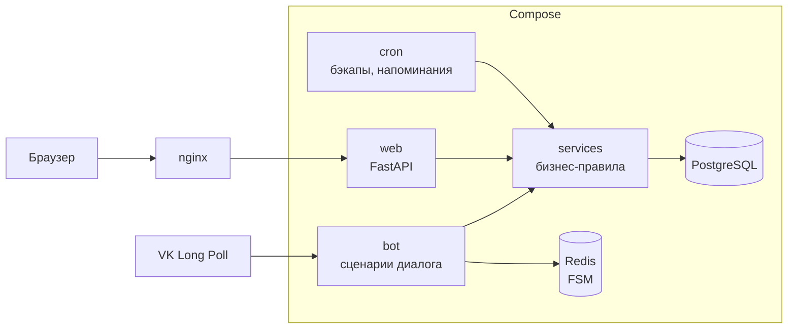

# Tickets

Учёт мест на студенческий концерт: один зал, один концерт, продажи через людей. Билетёры работают в **VK-боте** — оформляют брони, записывают оплаты по чекам, ставят резервы под гостей. **Веб** показывает покупателям схему зала со свободными местами, а организаторам — страницу оплат и список на вход в день концерта.

## Возможности

**Бот (VK, для билетёров)**
- Бронь начинается с пересылки сообщения покупателя, ответа на него или ссылки на профиль — бот сам находит покупателя и его бронь.
- Места вводятся диапазонами (`1-3, 5, 8-10`) с проверкой по схеме зала и занятости.
- Оплата N мест из брони; чек (фото или документ из пересланного сообщения) уходит админам.
- Удаление мест и брони, резервы под гостей (админ), список должников и автоматические напоминания билетёрам.
- Роли: билетёр, админ; владелец проекта управляет пользователями и получает технические уведомления и бэкапы.

**Веб**
- `/` — публичная схема зала: свободные и занятые места.
- `/payments` — для админа (вход по паролю): оплаты с чеками, места по статусам, сумма; кнопка «Проверено».
- `/concert-day` — кто на каком месте сидит, для входа в зал.

## Стек

Python 3.12 · [vkbottle](https://github.com/vkbottle/vkbottle) (Long Poll) · FastAPI + Jinja2 · SQLAlchemy 2 (async) + Alembic · PostgreSQL 18 (psycopg 3) · Redis 8 (состояние диалогов бота) · Docker Compose · uv, ruff, mypy, pytest + testcontainers.

## Архитектура



Бот, веб и фоновые задачи — интерфейсы над общим слоем `services` (брони, места, оплаты, отчёты, аудит). Главные решения:

- **Двойная продажа места невозможна на уровне базы** — частичный уникальный индекс «одно активное занятие на место». Гонка двух билетёров за одно место даёт понятный ответ «место занято», а не ошибку.
- **Одна операция — одна транзакция.** Сервисы не коммитят; транзакцию открывает граница (`unit_of_work()`): сценарий бота, запрос веба, задача. Изменения брони сериализуются блокировкой строки (`SELECT … FOR UPDATE`), поэтому две оплаты одной брони не выберут одни и те же места.
- **Всё записано в аудит** — в той же транзакции, что и изменение.
- **Схема — только миграциями Alembic**, по правилу expand/contract: новая версия базы совместима с предыдущей версией кода.
- **Состояние диалога** — pydantic-модели в Redis; нечитаемое состояние сбрасывается, а не роняет бота.

Подробно — [docs/architecture.md](docs/architecture.md).

```
src/tickets/    пакет приложения: models, services, bot, web, jobs, config
migrations/     миграции Alembic
tests/          unit/ (без Docker), integration/ (Postgres и Redis в контейнерах)
deploy/         деплой-скрипт, конфиг nginx, выпуск сертификата
layout.json     геометрия зала: ряды, места, проходы
```

## Запуск локально

Нужны Docker и [uv](https://docs.astral.sh/uv/).

```bash
uv sync                        # Python 3.12 и зависимости в .venv
uv run pre-commit install      # ruff и mypy перед каждым коммитом

cp .env.example .env           # несекретные настройки: VK_GROUP_ID, OWNER_VK_IDS, …
mkdir -m 700 secrets           # секреты — по файлу на каждый, только значение
for name in postgres_password redis_password cookie_secret; do
  python3 -c "import secrets; print(secrets.token_urlsafe(32))" > "secrets/$name"
done
echo "<токен сообщества VK>" > secrets/vk_bot_token
echo "<пароль страницы оплат>" > secrets/payments_password

docker compose watch           # postgres, redis, миграции, web на http://127.0.0.1:8000
```

`.env.example` подключает `compose.dev.yaml`: перезапуск веба при изменении кода, синхронизация файлов в контейнер, порт Postgres наружу. Бот и `cron` в dev — за профилями: `docker compose --profile bot up -d bot`.

## Тесты и проверки

```bash
uv run pytest                  # всё; интеграционные поднимают Postgres и Redis в контейнерах
uv run pytest tests/unit       # без Docker
uv run pytest --cov            # с покрытием
uv run ruff check . && uv run ruff format --check . && uv run mypy
```

Интеграционные тесты работают с настоящими Postgres и Redis: сервисы (включая гонки транзакций), сценарии бота с подменённым VK API, веб-роуты, миграции (схема после миграций сверяется со схемой моделей).

## Деплой

На сервере всё работает в Docker Compose; на хосте — только Docker и nginx (HTTPS через Let's Encrypt, прокси на `127.0.0.1:8000`).

```bash
bash deploy/deploy.sh          # на сервере: git pull → docker compose up --build --wait
```

При запуске Compose сначала снимает дамп базы (если есть новые миграции), затем применяет миграции и только потом перезапускает сервисы; деплой ждёт, пока все healthcheck станут зелёными. Бэкапы — каждый день, дамп уходит владельцу в VK.

Первичная настройка сервера, бэкапы и восстановление — [docs/operations.md](docs/operations.md).

## Документация

- [docs/architecture.md](docs/architecture.md) — устройство кода и правила: слои, транзакции, миграции, тесты.
- [docs/operations.md](docs/operations.md) — сервер: установка, обновление, бэкапы, восстановление.
- [docs/roadmap.md](docs/roadmap.md) — что сделано и что дальше.
- [docs/TZ.md](docs/TZ.md) — исходное техническое задание.
- [CLAUDE.md](CLAUDE.md) — подробная справка по проекту для разработки с Claude Code.
